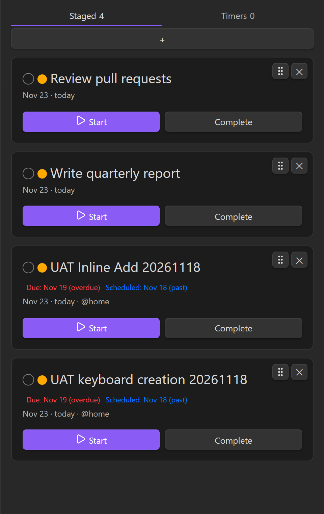
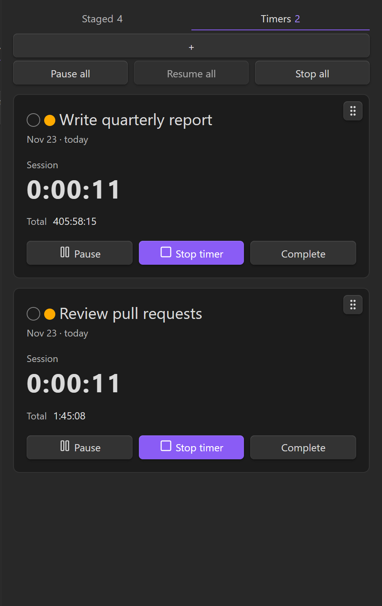

# TaskNotes Task Control

## What it is

An Obsidian plugin that adds a dockable pane for monitoring and controlling TaskNotes' regular (non-Pomodoro) task time tracking. TaskNotes already has a Pomodoro pane, but for normal task timing the only sign that a task is being timed is a small status-bar indicator in the bottom right of the window. This pane fills that gap: keep it open beside your notes to see what you are timing and how long you've spent on it, and start, pause, resume, stop or complete a task's timer in one or two clicks.





## Requirements

- Obsidian 1.12.2 or later. The current pane layouts have been checked in a running Obsidian vault. The Configure staged field settings button and physical mobile behavior remain unverified.
- TaskNotes 4.10.0 or later, installed and enabled. The pane is a companion to TaskNotes. If TaskNotes is missing, disabled or too old, the pane explains the issue and connects when TaskNotes becomes ready.

## Installation

### Install with BRAT (recommended)

1. In Obsidian, open **Settings → Community plugins → Browse**, find **TaskNotes**, install it, and enable it.
2. In the same Browse view, find **BRAT**, install it, and enable it.
3. Open the command palette and run **BRAT: Add a beta plugin for testing**.
4. Enter `judealnas/obsidian-tasknotes-task-ctrl` and add the plugin.
5. In **Settings → BRAT**, choose which release to track:
   - **Latest** follows the newest version and can include prereleases.
   - **Frozen version** stays on one release tag. Choose an available tag from the repository’s GitHub releases.
6. Open **Settings → Community plugins** and enable **TaskNotes Task Control**.

See the [BRAT guide](https://github.com/TfTHacker/obsidian42-brat/blob/main/BRAT-DEVELOPER-GUIDE.md) for details about latest and frozen versions. See the [0.4.0 release notes](docs/releases/0.4.0.md) for the release summary and verification limits.

### Manual install

1. Download `main.js`, `manifest.json` and `styles.css` from the [release you want](https://github.com/judealnas/obsidian-tasknotes-task-ctrl/releases).
2. Put the files in `<vault>/.obsidian/plugins/tasknotes-task-ctrl/`.
3. In **Settings → Community plugins**, enable **TaskNotes Task Control**.

To build from source, run `npm install` and `npm run build`, then copy the same three files from the repository root.

### Switch a vault between local and release builds

Requires Node.js 22 or later and Git. Install this plugin in the target vault first, then configure its location once:

```powershell
npm run vault:setup -- "C:\path\to\Your Vault"
```

This saves the path in Git-ignored `.vault-switch.local.json`. Setup checks the existing plugin ID and changes no vault files. It supports the standard `.obsidian` configuration folder and refuses linked or redirected vault/plugin directories.

Before switching, disable **TaskNotes Task Control** in Obsidian's Community plugins settings. Leave it disabled until the command finishes, then re-enable it. The commands check `.obsidian/community-plugins.json`; they do not control the running Obsidian process. Turn off BRAT automatic updates while using a local build.

```powershell
npm run vault:local                       # Build this checkout, including uncommitted changes
npm run vault:release -- 0.4.0              # Download this exact GitHub release
npm run vault:status                      # Identify the installed files
npm run vault:undo                        # Restore files from the previous switch
```

- Both sources replace only `main.js`, `manifest.json`, and `styles.css`. They preserve `data.json`, task notes, and other plugin files. The existing `npm run dev` and `npm run deploy` still target only the disposable dev-vault.
- Local switching runs the same TypeScript check and production bundler as `npm run build`. A failed build or invalid/incomplete download leaves the installed plugin untouched. Release downloads validate the plugin ID, exact manifest version, asset sizes, and GitHub-provided SHA-256 digests when available. `latest` is deliberately unsupported.
- Before replacement, the current plugin files and any `data.json` are backed up under Git-ignored `.vault-switch/`, separately for each vault. Backups can contain private saved state; keep this directory private. Backups are retained until you remove them yourself.
- Status compares file hashes and records the local Git commit plus whether the checkout had uncommitted changes. A matching version number alone does not identify a build. Files changed by BRAT or another tool are reported as unknown or changed. Status describes files on disk, not the code currently loaded by Obsidian.
- Undo restores the previous three plugin files, including a previously absent stylesheet. It leaves current saved data and task notes intact. Repeating undo switches back to the build it just replaced. A restored install that predates the switcher may have unknown build provenance.
- Replacement is atomic per file, not across all three files. Ordinary write failures trigger automatic restoration. An interrupted switch retains a recovery record: keep the plugin disabled and run `npm run vault:undo`. If a crashed process left `switch.lock`, first confirm no switch is running, then remove only the lock file named in the error and retry undo. Do not run other installers against the same vault during switching.

Keeping saved data does not guarantee that an older release can read a newer build's data. The backup is available for separate manual recovery; these commands never restore `data.json` automatically or reverse changes to TaskNotes task notes.

Run `npm run test:vault-switch` to exercise switching and recovery against temporary test vaults without opening Obsidian.

## Using the pane

Version 0.3.0 added **Staged** beside **Timers**, with independent saved order, task/running-timer counts, and a running cue on Timers. Version 0.4.0 uses plugin ID `tasknotes-task-ctrl` and installs in `.obsidian/plugins/tasknotes-task-ctrl/`; Obsidian command IDs use the `tasknotes-task-ctrl:` prefix. The saved pane view type remains `tasknotes-timer-pane` for layout compatibility. The repository is `judealnas/obsidian-tasknotes-task-ctrl`.

Cards use fixed details: staged date, relative age, and context on one line, for example **Nov 18 · today · @home**. Multiple contexts appear as **@home, @work**; missing contexts add no separator. Timer cards without a staged date show just their contexts. Tags are not displayed.

Cards in both tabs show clickable parent task names and a collapsed subtask summary, for example **Subtasks · 1 of 3 complete**. Expand the summary to see immediate subtasks, their completion status, and links to their notes. Status symbols are informational; the card's Complete action still applies to its main task. Empty or unavailable relationship sections are omitted. This requires TaskNotes' public relationship API; timers continue to work when those optional features are unavailable.

In either task picker, **Enter** selects a result and **Shift+Enter** creates a new task from the current search query using TaskNotes' natural-language parser. Creation waits for pending parsing; queries containing only properties must be edited to include a task title. The saved task is staged or added as an idle timer card. Creation happens inline; it does not open TaskNotes' separate creation window.

### Daily staging

At the top of **Settings → TaskNotes Task Control**, use **Configure staged field** to register **key `staged`**, type **Date**, with **no default value** in TaskNotes. The key is fixed. Setup only adds the field registration; it preserves existing TaskNotes fields, notes and task form layouts. If setup cannot run or the key conflicts with an existing field, configure it in TaskNotes settings → Task Properties → Custom User Fields. The button uses the theme accent color while setup is needed. Once configured, it becomes disabled with a green confirmation message. Setup uses TaskNotes internals and runs when you press the button. Incorrect or unreadable setup disables staging and explains how to recover.

- The full-width **+** button below the tabs opens a searchable batch picker when **Staged** is selected. Selected tasks are appended to the list. Multiple choices keep their selection order and the picker stays open. Completed, archived and already-staged tasks are hidden.
- Staging writes `staged: YYYY-MM-DD` through TaskNotes. Staged tasks stay until completed or unstaged; future dates stay hidden until that local calendar date. Cards show the number of calendar days since staging.
- Right-click a task and choose **Note actions → Stage task** to stage it without opening the picker. This also works from task titles in the timer pane. Already-staged tasks keep their existing date and order.
- Start, pause, resume, stop or complete from each staged card. **✕** unstages immediately, stopping regular timing or clearing a saved pause while protecting Pomodoro timing. It writes `staged: null`.
- **Complete** stops eligible regular timing before completion. Recurring tasks follow TaskNotes' resolved occurrence, which can differ from the requested calendar date on an off-schedule request. Repeated pane completion is protected against replay. Failures use Notices; successful completion is quiet.
- There is no Done today section or rollover-hour setting. Midnight only updates the calendar age and reveals eligible future-dated tasks; it never clears the list or writes task frontmatter.
- Drag a reorder handle or use its Up/Down keys. Dragging near the pane edges scrolls the list. On mobile, left-side **▲/▼** controls move a card within its own tab; screen readers receive its new position.

Completion safety records remain stored to avoid replaying uncertain or completed recurring writes. Refreshing the list does not collect external completion history.

Staging and recurring completion require TaskNotes **4.13.0+** and the relevant public API capabilities. Missing materialization capabilities disable the affected action with an explanation. Regular timers retain the **4.10.0+** floor. Native Phase 7 recurrence checks so far cover **4.18.2** only. Physical mobile-device and published BRAT-upgrade acceptance remain open. The current source removes the beta.1 Done today and custom rollover features; their former acceptance checks are superseded.

### Timer controls

With **Timers** selected, **Pause all**, **Resume all** and **Stop all** share one full-width row beneath **+**. The tabs and controls stay visible while the cards scroll.

- Open it with the ribbon icon "Open TaskNotes Task Control" or the command "Open timer pane". It opens in the right sidebar. If the pane is already open, it is revealed where it is instead of opening a second copy, and it stays in place across restarts.
- While a timer runs, the card shows the task title (click it to open the note; Ctrl/Cmd-click opens it in a new tab), the current session as H:MM:SS ticking every second, and the task's total tracked time including the running session.
- "Stop timer" stops only the timer the card displays.
- Several timers at once: the pane shows one card per timer, new timers at the top. Drag a card's handle (or press Up/Down arrow on it) to reorder; the order is remembered.
- With **Timers** selected, **+** below the tabs opens a searchable picker and adds an idle card to Timers without starting time tracking. Completed tasks remain selectable at the end of the list. Adding an already running or paused task leaves it unchanged.
- Added cards and their order are remembered across pane closure and Obsidian restarts. Choose **Start** on an idle card to start its timer through the normal TaskNotes controls. A failed Start keeps the card available to retry.
- The **✕** button on an idle Timers card removes it only from this local list. It does not change the task, its staging, or its time entries. Added cards follow note and folder renames and are removed when their notes are deleted. A save-failure Notice means the latest local changes may not survive a restart.
- "Stop all" stops regular timers sequentially and preserves the timer owned by an active Pomodoro. It is disabled when ownership cannot be verified or there is nothing eligible to stop.
- "Complete" beside Stop stops eligible regular timing before completing the task. If an action partly succeeds, a Notice explains what still needs checking; completed tasks are never rolled back automatically.
- Settings → TaskNotes Task Control → Completion status offers "Same as TaskNotes" (the first completed status) and TaskNotes' live completed statuses. A removed saved status falls back to the first completed status. No completed statuses means Complete is disabled.
- "Pause" on a card stops its TaskNotes time entry and keeps the card in place, marked "Paused", with the session time frozen. "Resume" starts a new TaskNotes entry on the same task and the session carries on from the paused value. Pause and Resume write only through TaskNotes, so its status bar, cards and totals stay in sync.
- "Pause all" and "Resume all" in the header pause every regular running timer, or resume every paused card, one at a time.
- Pauses are remembered across restarts. A pause follows its note when the note is renamed or moved, and is cleared when the note is deleted, the task gets a completed status, or a Pomodoro starts on that task. Starting the task's timer elsewhere in TaskNotes turns the paused card back into a running one.
- "Stop timer" on a paused card clears the pause without another TaskNotes write. "Complete" works on paused cards too. "Stop all" also clears every pause. Pause all, Resume all and Stop all leave idle added cards in place.
- A timer owned by an active Pomodoro is hidden from the pane and left alone by Stop all and Pause all. The Timers picker marks the Pomodoro's task "Pomodoro"; adding it does not start another timer. Idle Start uses the existing Pomodoro protections. If the pane can't check Pomodoro ownership it shows every timer with the note "Can't check Pomodoro. Showing all timers."
- The pane never stops a timer without a click. TaskNotes' own completion and archive settings still govern actions made elsewhere. All pane write controls are disabled while an action runs.

Differences from TaskNotes' own displays, all expected:

- Totals are summed to the second from the raw time entries. TaskNotes rounds each entry down to whole minutes, so the pane's total can be up to a minute per entry higher than TaskNotes' total.
- The pane always shows H:MM:SS. TaskNotes' status bar shows M:SS under an hour, so `0:42:17` in the pane is `42:17` in the status bar.
- TaskNotes' status bar hides timers on archived tasks. The pane does not.

## Development

Develop only in the repo's `dev-vault/` folder, never in your real vault. The build scripts only ever write into `dev-vault/.obsidian/plugins/tasknotes-task-ctrl/` (and `main.js` at the repo root for `npm run build`). The vault-switch commands install into the vault you explicitly configure. Run development tests in the disposable dev vault.

1. `npm install`
2. `npm run seed` creates `dev-vault/` with four seed tasks in `TaskNotes/Tasks/`. Re-running it leaves existing notes alone. `npm run seed -- --reset` restores the seed notes to their tracked contents. Neither deletes anything or touches `dev-vault/.obsidian/`.
3. Open `dev-vault/` as a vault in Obsidian ("Open folder as vault"), and turn off Restricted mode when asked.
4. One-time manual installs into the dev vault:
   - TaskNotes (native Phase 7 checks use 4.18.2), from Settings → Community plugins → Browse.
   - Hot Reload 0.3.1 from https://github.com/pjeby/hot-reload/releases. It isn't in the community directory: download its `main.js` and `manifest.json` into `dev-vault/.obsidian/plugins/hot-reload/`.
5. In Settings → Community plugins, enable TaskNotes, Hot Reload and TaskNotes Task Control.
6. `npm run dev` builds in watch mode into the dev vault. Hot Reload reloads the plugin about 0.75 s after `main.js` or `styles.css` changes. A `manifest.json` change needs a manual plugin toggle off and on.
7. `npm run deploy` does a one-shot build into the dev vault.
8. `npm run check` is the definition of done: the build, `tsc -noEmit`, ESLint with eslint-plugin-obsidianmd at zero warnings, Vitest, and the vault-switch tests must all pass.
9. Never commit `dev-vault/`. It is git-ignored because it holds third-party plugins and TaskNotes' `data.json`. Seed notes are tracked in `dev-vault-seed/` instead.

### Automated UAT (Windows dev only)

`scripts/uat/` starts a second Obsidian on the dev vault so Claude Code can run UAT through the browser DevTools protocol. It runs on a hidden Windows desktop with its own user-data dir under `%LOCALAPPDATA%\tasknotes-timer-pane-uat\userdata`. It never appears on screen and never takes focus, and it runs alongside your own Obsidian.

Before you start:

- Set up the main checkout's `dev-vault/` per the steps above, with TaskNotes and TaskNotes Task Control enabled once. You don't need to deploy a build first: `uat:start` builds the checkout you run it from and installs that build itself.
- Run `npm ci` in the checkout you want to test (the main checkout or a worktree) so it can build.
- Close `dev-vault` in your own Obsidian. The launcher refuses to start while your Obsidian has that vault open, because two instances on one vault would write conflicting changes.

Commands:

- `npm run uat:start` runs `npm run build` in the checkout that contains the script (the main checkout or a worktree), copies `main.js`, `manifest.json` and `styles.css` into the main checkout's `dev-vault/.obsidian/plugins/tasknotes-task-ctrl/`, and leaves `data.json` alone. Then it starts the instance, gets past the trust prompt and Restricted mode, and prints one `UAT Obsidian ready:` line with the TaskNotes version, API version, whether the pane loaded, `build=<checkout>@<commit>` (with `+dirty` when tracked files have uncommitted changes) and `mainjs=<hash>` of the installed `main.js`. If the build fails, nothing is installed or launched. Pass `-- -Vault <path> -Port <n>` to override the defaults.
- `npm run uat:start -- -SkipBuild` launches whatever build is already installed, with no build and no copy.
- `npm run uat:stop` stops only the UAT instance. Your own Obsidian is not touched.
- `npm run uat:smoke` starts and stops the instance while sampling the foreground window, and fails if the UAT instance ever had focus, if your own Obsidian processes changed, or if the installed `main.js` doesn't match the checkout's build.

The launcher only installs into a vault folder named `dev-vault`. It refuses any other `-Vault` unless you pass `-SkipBuild`, and it checks this before anything is built or copied.

To load a new build, run `npm run uat:start` again. It stops the previous instance first, so Hot Reload isn't needed. This replaces the dev vault's plugin build with the checkout's minified production build; run `npm run deploy` in the main checkout afterwards to go back to your own dev build.

The instance listens for DevTools connections on port 9333. That port is localhost-only but unauthenticated, so stop the instance when you're done. The `chrome-devtools` MCP server in `.mcp.json` connects to it; Claude Code needs one restart to load it. Like any Obsidian, the UAT instance saves its workspace layout into the vault's `.obsidian/` folder.

### Releasing

1. `npm version patch` (or `minor` / `major`) bumps `package.json`, `package-lock.json`, `manifest.json` and `versions.json`, commits, and tags the version without a `v` prefix.
2. `git push --follow-tags` pushes the commit and tag. The release workflow runs `npm run check`, confirms the tag matches `manifest.json`, and publishes a GitHub release with `main.js`, `manifest.json`, `styles.css` and `THIRD_PARTY_NOTICES.md`.

For a beta, use the same prerelease version in `package.json`, `package-lock.json`, `manifest.json`, and the matching tag without a `v` prefix (for example, `0.4.0-beta.1`). Tags containing a hyphen are published as GitHub prereleases and do not replace GitHub's Latest release. Release notes come from `docs/releases/<tag>.md` when present. BRAT's latest tracking may still select prereleases. Beta publication does not close outstanding stable-release acceptance checks.
